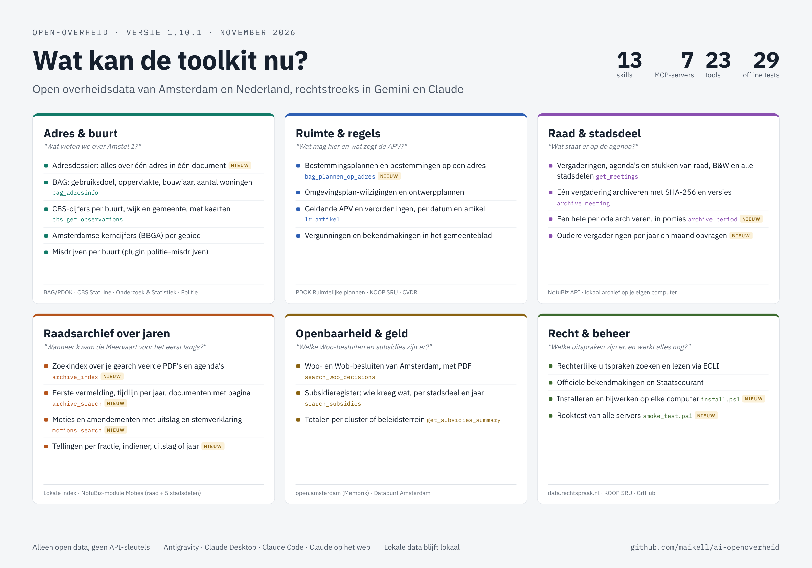

# AI Open Overheid Toolkit

**English** · [Nederlands](README.nl.md)

Skills and MCP servers that let an AI assistant work directly with Dutch and Amsterdam open government data: addresses and buildings (BAG), local regulations in force (CVDR), national statistics (CBS), council meetings and documents (with a local search index across years and motion tracking), zoning plans at an address, court rulings, official publications, neighbourhood statistics, Woo (Freedom of Information) decisions and the municipal subsidy register. One skill combines them into a dossier for a single address.

The toolkit is **AI-agnostic**. It is built on two open formats, so the same files work with several assistants:

- **Skills** use the `SKILL.md` format (Markdown with YAML front matter), supported by Google Antigravity (Gemini) and Claude.
- **Tools** are exposed through the [Model Context Protocol](https://modelcontextprotocol.io) (MCP), which any MCP-capable client can run.

All sources are public. No API keys or accounts are required.




## ✅ Supported environments

| Environment | Model | Skills | MCP servers | Install |
| :--- | :--- | :---: | :---: | :--- |
| Google Antigravity | Gemini | ✅ | ✅ | [Instructions](#google-antigravity-gemini) |
| Claude Desktop | Claude | ✅ | ✅ | [Instructions](#claude-desktop) |
| Claude Code | Claude | ✅ | ✅ | [Instructions](#claude-code) |
| Claude on the web | Claude | ✅ | ❌ | [Instructions](#claude-on-the-web) |
| Other agents | any | if `SKILL.md` is supported | if MCP is supported | [Instructions](#other-agents-and-models) |

Without the MCP servers the skills still work: they document the underlying APIs, so the assistant can call them directly.

---

## 🏛️ Included skills

The data is Dutch, so skill names and some instructions are in Dutch. Assistants handle questions in English or Dutch.

| Skill | What it does | Data source |
| :--- | :--- | :--- |
| `amsterdam-subsidies` | Search and aggregate the Amsterdam public subsidy register (amounts, applicants, departments). | Datapunt Amsterdam (CSV stream) + MCP server |
| `amsterdam-woo` | Search Woo/Wob (FOI) decisions and retrieve the released PDFs. | Memorix Mediabank (`open.amsterdam`) + MCP server |
| `bag` | Addresses and buildings: official address, use, floor area, construction year, units per building, CBS area codes, and the zoning plans and land-use designations at the address. | PDOK Locatieserver + BAG OGC API + PDOK Ruimtelijke plannen + MCP server |
| `omgevingsplan` | Geocode an address to coordinates/parcel and find zoning rules under the Environment and Planning Act (Omgevingswet). | PDOK Locatieserver, KOOP SRU |
| `rechtspraak` | Search and read Dutch court rulings by ECLI. | `data.rechtspraak.nl` |
| `officiele-bekendmakingen` | Municipal gazettes, Government Gazette, permits and regulations. | KOOP SRU 1.2 |
| `lokale-regelgeving` | Local regulations in force (APV, ordinances, policy rules) of municipalities, provinces and water boards, by date and article. | CVDR via KOOP SRU + MCP server |
| `amsterdam-kerncijfers` | District and neighbourhood statistics (BBGA). | Amsterdam Research & Statistics (O&S) |
| `cbs` | Statistics for every Dutch municipality, district and neighbourhood (population, income, housing, facilities), to compare areas and draw neighbourhood maps without a map service. Explained in `references/cbs-statline.md`. | CBS StatLine OData v4 (`datasets.cbs.nl`) + MCP server |
| `raadsinformatie` | Council and district committee meetings, agendas, motions, letters and minutes, with direct PDF links. | NotuBiz API (`amsterdam.raadsinformatie.nl`) + MCP server |
| `amsterdam-notubiz` | Download and archive the agenda and all documents of one meeting, or of all meetings over a period, into local folders, verified by SHA-256, with version numbers for changed documents and a README per meeting. | NotuBiz API + PowerShell scripts + MCP tools `archive_meeting`, `archive_period` |
| `raadsarchief` | Search your own archive of council and district documents across years (first mention, timeline per year, documents with snippet and page) and follow motions and amendments with outcome and vote text. | Local full-text index + NotuBiz motions module + MCP server |
| `adresdossier` | One address in, one dossier out: BAG, CBS neighbourhood figures, zoning plan at the location, permits, APV, Woo decisions, council documents and registered crime. Orchestrates the other skills. | All of the above (+ optional `politie-misdrijven` plugin) |

### MCP tools

| Server | Tools |
| :--- | :--- |
| `amsterdam-woo` | `search_woo_decisions`, `get_woo_document` |
| `amsterdam-subsidies` | `search_subsidies`, `get_subsidies_summary` |
| `amsterdam-raadsinformatie` | `get_meetings`, `get_meeting_agenda`, `archive_meeting`, `archive_period` |
| `raadsarchief` | `archive_index`, `archive_search`, `motions_sync`, `motions_search` |
| `cbs` | `cbs_search_tables`, `cbs_get_table_info`, `cbs_find_codes`, `cbs_get_observations` |
| `lokale-regelgeving` | `lr_zoek_regelingen`, `lr_inhoudsopgave`, `lr_artikel` |
| `bag` | `bag_zoek_adres`, `bag_adresinfo`, `bag_plannen_op_adres`, `bag_pand` |

## 📁 Repository layout

```
skills/<name>/SKILL.md            The skills (shared by all environments)
mcp/*.ps1                         Seven MCP servers (stdio, PowerShell)
tests/smoke_test.ps1              Smoke test for all MCP servers
install.ps1                       Install or update for Antigravity on any computer
rules/AGENTS.md                   General agent guidelines (loaded automatically by Antigravity)
plugin.json                       Plugin manifest for Antigravity
mcp_config.example.json           MCP config template for Antigravity
.claude-plugin/plugin.json        Plugin manifest for Claude
.claude-plugin/marketplace.json   Makes this repo installable as a Claude plugin marketplace
.mcp.json                         MCP config for Claude (relative paths)
```

## Requirements

- **Skills:** nothing extra; they work on Windows, macOS and Linux.
- **MCP servers:** PowerShell. Windows ships with it (`powershell.exe`). On macOS/Linux install [PowerShell 7](https://learn.microsoft.com/powershell/scripting/install/installing-powershell) (`pwsh`), see [Adapting to your machine](#-adapting-to-your-machine).
- **`amsterdam_kerncijfers.mjs` script** (optional): Node.js 18 or later.
- **`pdftotext`** (optional, from Poppler, Xpdf or Git for Windows): better PDF text for the `raadsarchief` index. Without it a built-in PowerShell reader is used. Neither does OCR.

---

## 🚀 Installation

### Google Antigravity (Gemini)

**Quickest, on any computer (Windows PowerShell):** this clones or updates the toolkit in `%USERPROFILE%\.gemini\config\plugins\open-overheid`, writes a user-name independent `mcp_config.json` (keeping servers you added yourself) and runs the smoke test:

```powershell
& ([scriptblock]::Create((irm https://raw.githubusercontent.com/maikell/ai-openoverheid/main/install.ps1)))
```

Run the same line again to update. From an existing clone: `powershell -NoProfile -ExecutionPolicy Bypass -File install.ps1` (add `-Offline` to skip live calls). On macOS/Linux use `pwsh install.ps1`. Prefer to do it by hand? Follow the steps below.

1. **Clone the repository** into the Antigravity plugins folder:

   ```powershell
   cd $env:USERPROFILE\.gemini\config\plugins
   git clone https://github.com/maikell/ai-openoverheid.git open-overheid
   ```

   Make sure `plugin.json` sits directly in `...\plugins\open-overheid\`.

2. **Create the MCP config** from the template:

   ```powershell
   cd open-overheid
   Copy-Item mcp_config.example.json mcp_config.json
   ```

   The template contains no user name: each server starts PowerShell with `-Command` and lets it resolve `$HOME` (`& (Join-Path $HOME '.gemini/config/plugins/open-overheid/mcp/...')`), so the same file works on every computer. If you cloned to another folder, replace those arguments with `-File` and the full path to the script. `mcp_config.json` is in `.gitignore`.

3. **Restart Antigravity** or reload plugins.

**Update:** run `install.ps1` again, or `git pull` in the `open-overheid` folder (then add any new servers from `mcp_config.example.json` to your `mcp_config.json`).

### Claude Desktop

1. Open **Customize** in the left sidebar and go to the **Plugins** tab.
2. Click **Add** → **Add marketplace** → **Add from a repository**.
3. Enter `maikell/ai-openoverheid`.
4. Install **open-overheid** from that marketplace and make sure it is enabled.

Skills and all MCP servers become available. Paths are relative (`${CLAUDE_PLUGIN_ROOT}`), so nothing needs editing.

### Claude Code

Inside a Claude Code session:

```text
/plugin marketplace add maikell/ai-openoverheid
/plugin install open-overheid@open-overheid
```

Or from a terminal (no slash):

```powershell
claude plugin marketplace add maikell/ai-openoverheid
claude plugin install open-overheid@open-overheid
```

Restart Claude Code afterwards. Update later with `claude plugin marketplace update open-overheid`.

Don't have Claude Code yet? Install it with `irm https://claude.ai/install.ps1 | iex` (Windows PowerShell) or `curl -fsSL https://claude.ai/install.sh | bash` (macOS/Linux), then open a new terminal. If `claude` is not recognised on Windows, run it as `& "$env:USERPROFILE\.local\bin\claude.exe"` or add that folder to your PATH. See the [setup docs](https://code.claude.com/docs/en/setup).

**Skills only, without the plugin:** copy the folders in `skills/` to `~/.claude/skills/` (Windows: `%USERPROFILE%\.claude\skills\`).

### Claude on the web

The web app installs skills as ZIP files, **one ZIP per skill**:

```powershell
cd ai-openoverheid\skills
Compress-Archive -Path omgevingsplan -DestinationPath ..\omgevingsplan.zip
# repeat for the other skills you want
```

Go to **Customize → Skills**, click **+** → **Create skill** → **Upload a skill**, upload the ZIP and toggle the skill on. Skills require **Code execution and file creation** (Settings → Capabilities). The folder name must match the `name` in `SKILL.md`.

MCP servers do not run in the web app; the skills fall back to calling the APIs directly. Don't combine this with the Desktop plugin on the same account, or the skills appear twice.

### Other agents and models

- **Skills:** any agent that loads `SKILL.md` folders can use `skills/` as is. For agents without skill support, use the `SKILL.md` files and `rules/AGENTS.md` as plain instructions or context.
- **MCP servers:** register the scripts in your client's MCP configuration as stdio servers, for example:

  ```json
  {
    "mcpServers": {
      "amsterdam-woo": {
        "command": "powershell.exe",
        "args": ["-NoProfile", "-ExecutionPolicy", "Bypass", "-File", "<path-to-repo>/mcp/amsterdam_woo_mcp.ps1"]
      },
      "amsterdam-subsidies": {
        "command": "powershell.exe",
        "args": ["-NoProfile", "-ExecutionPolicy", "Bypass", "-File", "<path-to-repo>/mcp/subsidies_mcp.ps1"]
      },
      "amsterdam-raadsinformatie": {
        "command": "powershell.exe",
        "args": ["-NoProfile", "-ExecutionPolicy", "Bypass", "-File", "<path-to-repo>/mcp/raadsinformatie_mcp.ps1"]
      },
      "cbs": {
        "command": "powershell.exe",
        "args": ["-NoProfile", "-ExecutionPolicy", "Bypass", "-File", "<path-to-repo>/mcp/cbs_mcp.ps1"]
      },
      "lokale-regelgeving": {
        "command": "powershell.exe",
        "args": ["-NoProfile", "-ExecutionPolicy", "Bypass", "-File", "<path-to-repo>/mcp/lokale_regelgeving_mcp.ps1"]
      },
      "bag": {
        "command": "powershell.exe",
        "args": ["-NoProfile", "-ExecutionPolicy", "Bypass", "-File", "<path-to-repo>/mcp/bag_mcp.ps1"]
      },
      "raadsarchief": {
        "command": "powershell.exe",
        "args": ["-NoProfile", "-ExecutionPolicy", "Bypass", "-File", "<path-to-repo>/mcp/raadsarchief_mcp.ps1"]
      }
    }
  }
  ```

---

## 🔧 Adapting to your machine

| Situation | What to change |
| :--- | :--- |
| **Different username or folder (Antigravity)** | Only your local `mcp_config.json`. Never put a personal path in `mcp_config.example.json`. |
| **macOS or Linux** | Replace `"powershell.exe"` with `"pwsh"` in `.mcp.json` (Claude) or `mcp_config.json` (Antigravity). In Antigravity use a path like `/Users/<name>/.gemini/config/plugins/open-overheid/mcp/subsidies_mcp.ps1`. |
| **Memorix key changed** | The Woo server uses the public key that open.amsterdam itself uses. If it changes, set the `MEMORIX_API_KEY` environment variable; the current key can be found in the network requests of `open.amsterdam/woo-zoeken`. |
| **Subsidy cache** | The server caches the CSV for up to 12 hours in an `antigravity_subsidies` folder in the system temp directory (Windows: `%TEMP%`). Delete that folder to refresh immediately. |
| **Archive folder** | `archive_meeting`, `archive_period` and the `raadsarchief` tools use `Documents/Raadsinformatie` unless you set the environment variable `OPEN_OVERHEID_ARCHIVE_ROOT` (or pass `root`). The search index and motion cache live in `_index/` inside that folder; delete it to rebuild. |
| **ExecutionPolicy** | The servers start with `-ExecutionPolicy Bypass` because the scripts are unsigned. This applies only to that process. Read the scripts before running them if you got them from someone else. |

Files are UTF-8 without BOM. Keep the `.ps1` files ASCII (no accented characters), or Windows PowerShell 5.1 will display them incorrectly.

---

## 🩺 Testing the MCP servers

`tests/smoke_test.ps1` starts every server from `.mcp.json` the way a client does and checks `initialize`, `tools/list` (expected tools, complete definitions), error codes for unknown tools and invalid input, and one or two real calls per server against the live sources. The `raadsarchief` server is tested on a temporary mini-archive.

```powershell
# Windows, from the plugin folder: everything, including live calls
powershell -NoProfile -ExecutionPolicy Bypass -File tests\smoke_test.ps1

# Without network, or for one or more servers
powershell -NoProfile -ExecutionPolicy Bypass -File tests\smoke_test.ps1 -Offline
powershell -NoProfile -ExecutionPolicy Bypass -File tests\smoke_test.ps1 -Server bag,raadsarchief

# macOS/Linux
pwsh tests/smoke_test.ps1 -Shell pwsh
```

It prints a table with PASS/FAIL per check and exits with code 1 if anything failed (`-JsonReport <file>` writes the results as JSON). Run it after updating the plugin, or when a tool stops answering.

---

## 💡 Example questions

- *"Which subsidies has the Gemeente Amsterdam granted in Stadsdeel Nieuw-West?"*
- *"Find Woo decisions by the Gemeente Amsterdam about waste collection and open the decision document."*
- *"What zoning rules and environmental plans apply around Amstel 1 in Amsterdam?"*
- *"Find recent rulings on environmental law in which the Gemeente Amsterdam is a party."*
- *"Give me the key figures for the neighbourhood around Amstel 1."*
- *"What is on the agenda of the next Stadsdeel Nieuw-West committee meeting?"*
- *"Compare the share of residents aged 65+ in Osdorp with Amsterdam as a whole (CBS)."*
- *"What does the Amsterdam APV say about terraces?"*
- *"What is the construction year and use of Amstel 1 in Amsterdam?"*
- *"Make an address dossier for Amstel 1 in Amsterdam."*
- *"Archive all Stadsdeelcommissie meetings of Stadsdeel Nieuw-West since 2023 and tell me when the Meervaart first came up."*
- *"Which motions about waste were submitted in the Amsterdam city council since 2024, and how many were adopted per party?"*

## 🧪 Example data convention

Examples, tests and prompts use only the address **Amstel 1** (City Hall / Stopera) and the organisations **Gemeente Amsterdam** and **Stadsdeel Nieuw-West**. Do not use real people, companies or other addresses. Exception: technical value lists (such as the court codes in the `rechtspraak` skill, the NotuBiz organisation IDs in the `raadsinformatie` skill and the CBS area codes in the `cbs` skill).

Live results can of course contain other names and addresses; those come from the public sources, not from this repository.

## 🔒 Security

- **No keys of your own.** The only key in the code is the public key that open.amsterdam uses itself.
- **Input validation:** `get_woo_document` accepts only a valid UUID, `rows` is capped at 50 and the council tools accept only positive integer IDs, so manipulated input cannot reach other endpoints. Folder arguments must be absolute paths without `..`; dates, names and queries are checked against strict patterns.
- **Local data stays local.** The archive, search index and motion cache are plain files on your own computer; nothing is uploaded.
- **Places, not people.** The `adresdossier` skill describes a building and its surroundings. It does not look up owners or residents.
- **Retrieved documents are data, not instructions.** Woo documents and rulings contain third-party text; the assistant should not follow instructions found in them.
- **No scraping:** only official REST, SRU and XML web services, see `rules/AGENTS.md`.

## License

GPL-3.0, see [LICENSE](LICENSE).
