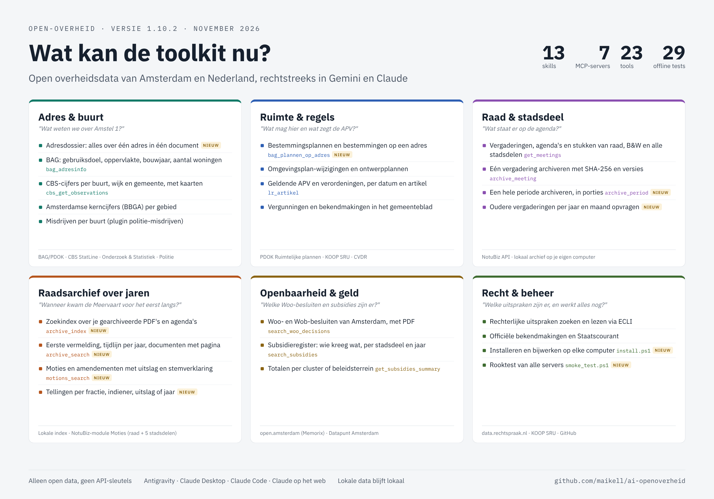
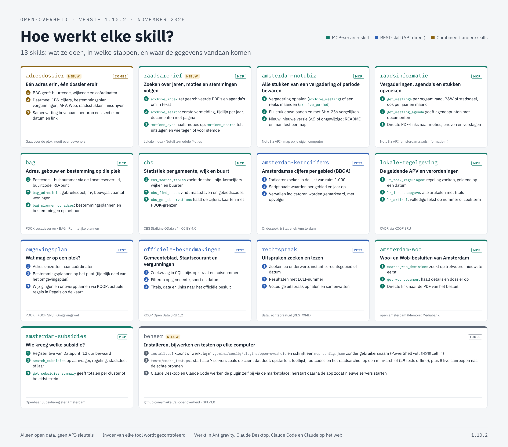

# AI Open Overheid Toolkit

[English](README.md) · **Nederlands**

Skills en MCP-servers waarmee een AI-assistent rechtstreeks werkt met Nederlandse en Amsterdamse open overheidsdata: adressen en gebouwen (BAG), geldende lokale regelgeving (CVDR), landelijke statistiek (CBS), raadsvergaderingen en raadsstukken (met een lokale zoekindex over jaren en het volgen van moties), omgevingsplannen op een adres, rechterlijke uitspraken, officiële bekendmakingen, buurtstatistieken, Woo-besluiten en het subsidieregister. Eén skill bundelt ze tot een dossier voor één adres.

De toolkit is **AI-agnostisch**. Hij is gebouwd op twee open formaten, zodat dezelfde bestanden met verschillende assistenten werken:

- **Skills** gebruiken het `SKILL.md`-formaat (Markdown met YAML-kop), dat Google Antigravity (Gemini) en Claude ondersteunen.
- **Tools** lopen via het [Model Context Protocol](https://modelcontextprotocol.io) (MCP), dat elke MCP-client kan draaien.

Alle bronnen zijn openbaar. Je hebt geen API-sleutels of accounts nodig.






## ✅ Ondersteunde omgevingen

| Omgeving | Model | Skills | MCP-servers | Installatie |
| :--- | :--- | :---: | :---: | :--- |
| Google Antigravity | Gemini | ✅ | ✅ | [Instructies](#google-antigravity-gemini) |
| Claude Desktop | Claude | ✅ | ✅ | [Instructies](#claude-desktop) |
| Claude Code | Claude | ✅ | ✅ | [Instructies](#claude-code) |
| Claude op het web | Claude | ✅ | ❌ | [Instructies](#claude-op-het-web) |
| Andere agents | elk | als `SKILL.md` wordt ondersteund | als MCP wordt ondersteund | [Instructies](#andere-agents-en-modellen) |

Zonder MCP-servers werken de skills ook: ze beschrijven de onderliggende API's, zodat de assistent die zelf kan aanroepen.

---

## 🏛️ Inbegrepen skills

| Skill | Wat het doet | Databron |
| :--- | :--- | :--- |
| `amsterdam-subsidies` | Doorzoeken en optellen van het Openbaar Subsidieregister (bedragen, aanvragers, clusters). | Datapunt Amsterdam (CSV-stream) + MCP-server |
| `amsterdam-woo` | Zoeken in Woo- en Wob-besluiten en ophalen van de PDF's. | Memorix Mediabank (`open.amsterdam`) + MCP-server |
| `bag` | Adressen en gebouwen: officieel adres, gebruiksdoel, oppervlakte, bouwjaar, aantal verblijfsobjecten, CBS-gebiedscodes, en de bestemmingsplannen en bestemmingen op het adres. | PDOK Locatieserver + BAG OGC API + PDOK Ruimtelijke plannen + MCP-server |
| `omgevingsplan` | Adres naar coördinaten/perceel, en planregels onder de Omgevingswet. | PDOK Locatieserver, KOOP SRU |
| `rechtspraak` | Zoeken en lezen van uitspraken via ECLI. | `data.rechtspraak.nl` |
| `officiele-bekendmakingen` | Gemeentebladen, Staatscourant, vergunningen en regelgeving. | KOOP SRU 1.2 |
| `lokale-regelgeving` | Geldende lokale regelgeving (APV, verordeningen, beleidsregels) van gemeenten, provincies en waterschappen, per datum en artikel. | CVDR via KOOP SRU + MCP-server |
| `amsterdam-kerncijfers` | Wijk- en buurtstatistieken (BBGA). | Onderzoek & Statistiek Amsterdam |
| `cbs` | Statistieken voor elke gemeente, wijk en buurt in Nederland (bevolking, inkomen, wonen, voorzieningen), om gebieden te vergelijken en buurtkaarten te maken zonder kaartdienst. Uitleg in `references/cbs-statline.md`. | CBS StatLine OData v4 (`datasets.cbs.nl`) + MCP-server |
| `raadsinformatie` | Vergaderingen van gemeenteraad en stadsdeelcommissies, agenda's, moties, brieven en verslagen, met directe PDF-links. | NotuBiz API (`amsterdam.raadsinformatie.nl`) + MCP-server |
| `amsterdam-notubiz` | De agenda en alle stukken van één vergadering, of van alle vergaderingen in een periode, downloaden en archiveren in lokale mappen, gecontroleerd met SHA-256, met versienummers voor gewijzigde stukken en een README per vergadering. | NotuBiz API + PowerShell-scripts + MCP-tools `archive_meeting`, `archive_period` |
| `raadsarchief` | Zoeken in je eigen archief van raads- en stadsdeelstukken over jaren heen (eerste vermelding, tijdlijn per jaar, documenten met fragment en pagina) en moties en amendementen volgen met uitslag en stemverklaring. | Lokale zoekindex + NotuBiz-module Moties + MCP-server |
| `adresdossier` | Eén adres erin, één dossier eruit: BAG, CBS-buurtcijfers, bestemmingsplan op de locatie, vergunningen, APV, Woo-besluiten, raadsstukken en geregistreerde misdrijven. Stuurt de andere skills aan. | Alle bronnen hierboven (+ optioneel de plugin `politie-misdrijven`) |

### MCP-tools

| Server | Tools |
| :--- | :--- |
| `amsterdam-woo` | `search_woo_decisions`, `get_woo_document` |
| `amsterdam-subsidies` | `search_subsidies`, `get_subsidies_summary` |
| `amsterdam-raadsinformatie` | `get_meetings`, `get_meeting_agenda`, `archive_meeting`, `archive_period` |
| `raadsarchief` | `archive_index`, `archive_search`, `motions_sync`, `motions_search` |
| `cbs` | `cbs_search_tables`, `cbs_get_table_info`, `cbs_find_codes`, `cbs_get_observations` |
| `lokale-regelgeving` | `lr_zoek_regelingen`, `lr_inhoudsopgave`, `lr_artikel` |
| `bag` | `bag_zoek_adres`, `bag_adresinfo`, `bag_plannen_op_adres`, `bag_pand` |

## 📁 Opbouw

```
skills/<naam>/SKILL.md            De skills (gedeeld door alle omgevingen)
mcp/*.ps1                         Zeven MCP-servers (stdio, PowerShell)
tests/smoke_test.ps1              Rooktest voor alle MCP-servers
install.ps1                       Installeren of bijwerken voor Antigravity op elke computer
rules/AGENTS.md                   Algemene richtlijnen (Antigravity laadt dit automatisch)
plugin.json                       Pluginbeschrijving voor Antigravity
mcp_config.example.json           MCP-voorbeeldconfiguratie voor Antigravity
.claude-plugin/plugin.json        Pluginbeschrijving voor Claude
.claude-plugin/marketplace.json   Maakt deze repo installeerbaar als Claude-pluginmarketplace
.mcp.json                         MCP-configuratie voor Claude (relatieve paden)
```

## Vereisten

- **Skills:** niets extra's; ze werken op Windows, macOS en Linux.
- **MCP-servers:** PowerShell. Windows heeft dit standaard (`powershell.exe`). Op macOS/Linux installeer je [PowerShell 7](https://learn.microsoft.com/powershell/scripting/install/installing-powershell) (`pwsh`), zie [Aanpassen voor jouw computer](#-aanpassen-voor-jouw-computer).
- **Script `amsterdam_kerncijfers.mjs`** (optioneel): Node.js 18 of nieuwer.
- **`pdftotext`** (optioneel, uit Poppler, Xpdf of Git for Windows): betere PDF-tekst voor de zoekindex van `raadsarchief`. Zonder dit programma gebruikt de index een ingebouwde PowerShell-lezer. Geen van beide doet OCR.

---

## 🚀 Installatie

### Google Antigravity (Gemini)

**Snelst, op elke computer (Windows PowerShell):** dit kloont of werkt de toolkit bij in `%USERPROFILE%\.gemini\config\plugins\open-overheid`, schrijft een `mcp_config.json` zonder gebruikersnaam (servers die je zelf toevoegde blijven staan) en draait de rooktest:

```powershell
& ([scriptblock]::Create((irm https://raw.githubusercontent.com/maikell/ai-openoverheid/main/install.ps1)))
```

Dezelfde regel nog eens draaien werkt bij. Vanuit een bestaande kloon: `powershell -NoProfile -ExecutionPolicy Bypass -File install.ps1` (met `-Offline` zonder live aanroepen). Op macOS/Linux: `pwsh install.ps1`. Liever met de hand? Volg dan de stappen hieronder.

1. **Repository plaatsen** in de plugins-map:

   ```powershell
   cd $env:USERPROFILE\.gemini\config\plugins
   git clone https://github.com/maikell/ai-openoverheid.git open-overheid
   ```

   Controleer dat `plugin.json` direct in `...\plugins\open-overheid\` staat.

2. **MCP-configuratie maken** vanuit het voorbeeld:

   ```powershell
   cd open-overheid
   Copy-Item mcp_config.example.json mcp_config.json
   ```

   Het voorbeeld bevat geen gebruikersnaam: elke server start PowerShell met `-Command` en laat PowerShell zelf `$HOME` invullen (`& (Join-Path $HOME '.gemini/config/plugins/open-overheid/mcp/...')`), dus hetzelfde bestand werkt op elke computer. Heb je naar een andere map gekloond, vervang die argumenten dan door `-File` en het volledige pad naar het script. `mcp_config.json` staat in `.gitignore`.

3. **Herstart Antigravity** of herlaad de plugins.

**Bijwerken:** draai `install.ps1` opnieuw, of `git pull` in de map `open-overheid` (zet daarna nieuwe servers uit `mcp_config.example.json` in je `mcp_config.json`).

### Claude Desktop

1. Open **Customize** in de linkerzijbalk en ga naar het tabblad **Plugins**.
2. Klik op **Add** → **Add marketplace** → **Add from a repository**.
3. Vul in: `maikell/ai-openoverheid`.
4. Installeer **open-overheid** uit die marketplace en zet hem aan.

De skills en alle MCP-servers zijn dan beschikbaar. De paden zijn relatief (`${CLAUDE_PLUGIN_ROOT}`), dus je hoeft niets aan te passen.

### Claude Code

Binnen een Claude Code-sessie:

```text
/plugin marketplace add maikell/ai-openoverheid
/plugin install open-overheid@open-overheid
```

Of vanuit een terminal (zonder schuine streep):

```powershell
claude plugin marketplace add maikell/ai-openoverheid
claude plugin install open-overheid@open-overheid
```

Herstart Claude Code daarna. Bijwerken doe je later met `claude plugin marketplace update open-overheid`.

Heb je Claude Code nog niet? Installeer het met `irm https://claude.ai/install.ps1 | iex` (Windows PowerShell) of `curl -fsSL https://claude.ai/install.sh | bash` (macOS/Linux) en open een nieuw terminalvenster. Herkent Windows `claude` niet, gebruik dan `& "$env:USERPROFILE\.local\bin\claude.exe"` of zet die map in je PATH. Zie de [installatiedocumentatie](https://code.claude.com/docs/en/setup).

**Alleen de skills, zonder plugin:** kopieer de mappen uit `skills/` naar `~/.claude/skills/` (Windows: `%USERPROFILE%\.claude\skills\`).

### Claude op het web

De webapp installeert skills als ZIP-bestand, **één ZIP per skill**:

```powershell
cd ai-openoverheid\skills
Compress-Archive -Path omgevingsplan -DestinationPath ..\omgevingsplan.zip
# herhaal voor de andere skills die je wilt gebruiken
```

Ga naar **Customize → Skills**, klik op **+** → **Create skill** → **Upload a skill**, upload de ZIP en zet de skill aan. Skills hebben **Code execution and file creation** nodig (Settings → Capabilities). De mapnaam moet gelijk zijn aan de `name` in `SKILL.md`.

MCP-servers draaien niet in de webapp; de skills roepen de API's dan zelf aan. Combineer dit niet met de Desktop-plugin op hetzelfde account, anders staan de skills dubbel.

### Andere agents en modellen

- **Skills:** elke agent die `SKILL.md`-mappen laadt, kan `skills/` direct gebruiken. Voor agents zonder skill-ondersteuning gebruik je de `SKILL.md`-bestanden en `rules/AGENTS.md` als gewone instructies of context.
- **MCP-servers:** registreer de scripts als stdio-servers in de MCP-configuratie van je client, bijvoorbeeld:

  ```json
  {
    "mcpServers": {
      "amsterdam-woo": {
        "command": "powershell.exe",
        "args": ["-NoProfile", "-ExecutionPolicy", "Bypass", "-File", "<pad-naar-repo>/mcp/amsterdam_woo_mcp.ps1"]
      },
      "amsterdam-subsidies": {
        "command": "powershell.exe",
        "args": ["-NoProfile", "-ExecutionPolicy", "Bypass", "-File", "<pad-naar-repo>/mcp/subsidies_mcp.ps1"]
      },
      "amsterdam-raadsinformatie": {
        "command": "powershell.exe",
        "args": ["-NoProfile", "-ExecutionPolicy", "Bypass", "-File", "<pad-naar-repo>/mcp/raadsinformatie_mcp.ps1"]
      },
      "cbs": {
        "command": "powershell.exe",
        "args": ["-NoProfile", "-ExecutionPolicy", "Bypass", "-File", "<pad-naar-repo>/mcp/cbs_mcp.ps1"]
      },
      "lokale-regelgeving": {
        "command": "powershell.exe",
        "args": ["-NoProfile", "-ExecutionPolicy", "Bypass", "-File", "<pad-naar-repo>/mcp/lokale_regelgeving_mcp.ps1"]
      },
      "bag": {
        "command": "powershell.exe",
        "args": ["-NoProfile", "-ExecutionPolicy", "Bypass", "-File", "<pad-naar-repo>/mcp/bag_mcp.ps1"]
      },
      "raadsarchief": {
        "command": "powershell.exe",
        "args": ["-NoProfile", "-ExecutionPolicy", "Bypass", "-File", "<pad-naar-repo>/mcp/raadsarchief_mcp.ps1"]
      }
    }
  }
  ```

---

## 🔧 Aanpassen voor jouw computer

| Situatie | Wat je aanpast |
| :--- | :--- |
| **Andere gebruikersnaam of map (Antigravity)** | Alleen je lokale `mcp_config.json`. Neem nooit een persoonlijk pad op in `mcp_config.example.json`. |
| **macOS of Linux** | Vervang `"powershell.exe"` door `"pwsh"` in `.mcp.json` (Claude) of `mcp_config.json` (Antigravity). Gebruik in Antigravity een pad als `/Users/<naam>/.gemini/config/plugins/open-overheid/mcp/subsidies_mcp.ps1`. |
| **Memorix-sleutel gewijzigd** | De Woo-server gebruikt de publieke sleutel die open.amsterdam zelf gebruikt. Verandert die, zet dan de omgevingsvariabele `MEMORIX_API_KEY`; de actuele sleutel vind je in de netwerkverzoeken van `open.amsterdam/woo-zoeken`. |
| **Cache van subsidies** | De server bewaart de CSV maximaal 12 uur in de map `antigravity_subsidies` in de tijdelijke map van het systeem (Windows: `%TEMP%`). Verwijder die map om direct te verversen. |
| **Archiefmap** | `archive_meeting`, `archive_period` en de `raadsarchief`-tools gebruiken `Documenten/Raadsinformatie`, tenzij je de omgevingsvariabele `OPEN_OVERHEID_ARCHIVE_ROOT` zet (of `root` meegeeft). De zoekindex en de motiecache staan in `_index/` in die map; verwijder die map om alles opnieuw op te bouwen. |
| **ExecutionPolicy** | De servers starten met `-ExecutionPolicy Bypass` omdat de scripts niet ondertekend zijn. Dat geldt alleen voor dit proces. Lees de scripts als je ze van een derde krijgt. |

Bestanden zijn UTF-8 zonder BOM. Houd de `.ps1`-bestanden ASCII (geen accenten), anders toont Windows PowerShell 5.1 tekens verkeerd.

---

## 🩺 De MCP-servers testen

`tests/smoke_test.ps1` start elke server uit `.mcp.json` zoals een client dat doet en controleert `initialize`, `tools/list` (verwachte tools, volledige definities), de foutcodes bij een onbekende tool en bij ongeldige invoer, en per server een of twee echte aanroepen naar de live bronnen. De `raadsarchief`-server wordt getest op een tijdelijk mini-archief.

```powershell
# Windows, vanuit de pluginmap: alles, inclusief live aanroepen
powershell -NoProfile -ExecutionPolicy Bypass -File tests\smoke_test.ps1

# Zonder netwerk, of voor een of meer servers
powershell -NoProfile -ExecutionPolicy Bypass -File tests\smoke_test.ps1 -Offline
powershell -NoProfile -ExecutionPolicy Bypass -File tests\smoke_test.ps1 -Server bag,raadsarchief

# macOS/Linux
pwsh tests/smoke_test.ps1 -Shell pwsh
```

Je krijgt een tabel met PASS/FAIL per controle; de exitcode is 1 als er iets mislukt (`-JsonReport <bestand>` schrijft de resultaten als JSON). Draai hem na een update van de plugin, of als een tool niet meer antwoordt.

---

## 💡 Voorbeeldvragen

- *"Welke subsidies heeft de Gemeente Amsterdam verleend in Stadsdeel Nieuw-West?"*
- *"Zoek Woo-besluiten van de Gemeente Amsterdam over afvalinzameling en open het besluitdocument."*
- *"Wat zijn de ruimtelijke regels en omgevingsplannen rond Amstel 1 in Amsterdam?"*
- *"Zoek recente uitspraken over omgevingsrecht waarin de Gemeente Amsterdam partij is."*
- *"Geef de kerncijfers voor de buurt rond Amstel 1."*
- *"Wat staat er op de agenda van de eerstvolgende vergadering van Stadsdeel Nieuw-West?"*
- *"Vergelijk het aandeel inwoners van 65 jaar of ouder in Osdorp met heel Amsterdam (CBS)."*
- *"Wat zegt de APV van Amsterdam over terrassen?"*
- *"Wat is het bouwjaar en gebruiksdoel van Amstel 1 in Amsterdam?"*
- *"Maak een adresdossier voor Amstel 1 in Amsterdam."*
- *"Archiveer alle vergaderingen van de Stadsdeelcommissie Nieuw-West sinds 2023 en vertel wanneer de Meervaart voor het eerst langskwam."*
- *"Welke moties over afval zijn er sinds 2024 in de Amsterdamse gemeenteraad ingediend, en hoeveel per partij zijn aangenomen?"*

## 🧪 Conventie voor voorbeelddata

Voorbeelden, tests en prompts gebruiken uitsluitend het adres **Amstel 1** (Stadhuis/Stopera) en de organisaties **Gemeente Amsterdam** en **Stadsdeel Nieuw-West**. Gebruik geen echte personen, bedrijven of andere adressen. Uitzondering: technische waardelijsten (zoals de gerechtscodes in de skill `rechtspraak`, de NotuBiz-organisatie-ID's in de skill `raadsinformatie` en de CBS-gebiedscodes in de skill `cbs`).

Live resultaten kunnen natuurlijk andere namen en adressen bevatten; die komen uit de openbare bronnen, niet uit deze repository.

## 🔒 Veiligheid

- **Geen eigen sleutels nodig.** De enige sleutel in de code is de publieke sleutel die open.amsterdam zelf gebruikt.
- **Invoer wordt gecontroleerd:** `get_woo_document` accepteert alleen een geldig UUID, `rows` is begrensd op 50 en de raadsinformatie-tools accepteren alleen positieve gehele getallen als ID, zodat gemanipuleerde invoer geen andere endpoints kan aanroepen. Mappen moeten absolute paden zonder `..` zijn; datums, namen en zoekvragen worden tegen strikte patronen gecontroleerd.
- **Lokale data blijft lokaal.** Het archief, de zoekindex en de motiecache zijn gewone bestanden op je eigen computer; er wordt niets geüpload.
- **Plekken, geen mensen.** De skill `adresdossier` beschrijft een gebouw en de omgeving. Hij zoekt geen eigenaren of bewoners op.
- **Opgehaalde documenten zijn data, geen instructies.** Woo-documenten en uitspraken bevatten tekst van derden; de assistent hoort daar geen opdrachten uit op te volgen.
- **Geen scraping:** alleen officiële REST-, SRU- en XML-webservices, zie `rules/AGENTS.md`.

## Licentie

GPL-3.0, zie [LICENSE](LICENSE).
